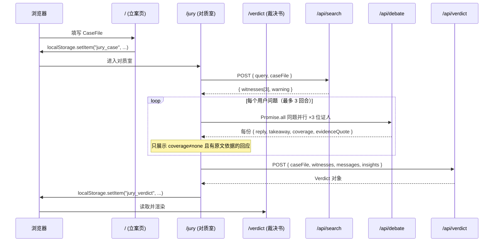

# 决策陪审团 · 接口契约文档

> 面向协作开发 / 联调 / 答辩。文档对应当前 `main` 工作区代码（Next.js 16 App Router，2026-11-26）。
> 所有接口均为 **POST + JSON**，无鉴权、无数据库；案卷状态由浏览器 `localStorage` 在页面间传递。

---

## 1. 快速开始

```bash
cd decision-jury
npm install                    # 首次或删除 node_modules 后
npm run dev                    # 开发模式，默认 http://localhost:3000
# 本机 Turbopack 有权限问题时改用：npx next dev --webpack

# 生产模式（贴近线上 / 演示）
npx next build --webpack
npx next start
```

| 项 | 值 |
|---|---|
| Base URL（本地） | `http://localhost:3000` |
| Content-Type | `application/json` |
| 鉴权 | 无（前端直调，服务端密钥不下发） |
| 模型 | 智谱 `glm-4-flash` |
| 上游 | 知乎开发者检索 API `GET https://developer.zhihu.com/api/v1/content/zhihu_search` |

### 环境变量（项目根 `.env.local`，不入库）

| 变量 | 用途 | 缺失时行为 |
|---|---|---|
| `ZHIHU_ACCESS_SECRET` | 知乎检索 Bearer Token | `/api/search` 返回 3 位明确标注的「演示角色」 |
| `ZHIPU_API_KEY` | 智谱大模型 | `/api/debate`、`/api/verdict` 返回结构化保底内容并带 `warning` |

> 缺密钥**不会报错崩溃**，产品会降级继续跑完流程——这是刻意设计，方便无密钥环境演示。

---

## 2. 数据模型

> ⚠️ 目前 `CaseFile` / `Witness` 等类型在 `app/page.tsx`、`app/jury/page.tsx`、三个 route 里**各定义一份，没有共享 types 文件**。改字段时请全局搜索同步修改。

### CaseFile（案卷）

| 字段 | 类型 | 必填 | 说明 |
|---|---|---|---|
| `mode` | `"single" \| "compare" \| "premortem"` | 是 | 单案对质 / 二选一 / 事前验尸，决定追问与裁决模板 |
| `decision` | string | 是 | 正在犹豫的决定 |
| `reason` | string | 是 | 最依赖的理由（事前验尸下为最担心的失败） |
| `constraint` | string | 否 | 底线 / 限制条件 |
| `options` | string[] | compare 必填 | A / B 两个选项，其余模式传 `[]` |
| `createdAt` | string | 否 | 前端写入的 ISO 时间，服务端忽略 |

### Witness（证人）

| 字段 | 类型 | 说明 |
|---|---|---|
| `name` | string | 展示名，真实证人为 `证人 A/B/C`，演示为 `演示证人 A/B/C` |
| `tag` | string | 作者名 / 身份标签 |
| `role` | string | `经历核对` / `风险核对` / `行动核对`（按席位顺序分配） |
| `quote` | string | 证词摘要，展示用；真实证人取正文前 180 字 |
| `content` | string | 完整证词，最多 5000 字；**模型实际读取的字段** |
| `sourceUrl` | string | 知乎原文链接；演示角色为 `""` |
| `title` | string | 回答标题 |
| `isDemo` | boolean | `true` = 明确标注的演示角色，**不得冒充真实回答** |

### Message / Insight

```ts
type Message = {
  role: "user" | "witness" | "guide"
  text: string
  who?: string            // 证人回应时=证人 name
  witnessIndex?: number
  note?: boolean          // 是否为「看山笔记」
  coverage?: "direct" | "partial"
}
type Insight = { text: string; witness: string; round: number }
type Strategy = "证据追问" | "适用性异议" | "行动追问"
```

### Verdict（裁决，见 §5）

---

## 3. 调用时序



**关键交互约定（改前端前必读）**

1. 一个问题必须**同题并行询问全部证人**（`Promise.all`），不是逐个切换。
2. 只有 `coverage` 为 `direct` / `partial` 且通过服务端证据校验的回应才入卷；未覆盖的证人不强行作答、**不自动轮转**。
3. 回合数按**用户提问数**计（`jury_asked`），不是按证人数量。
4. 只有入卷的 `insights` 会传给 `/api/verdict` 参与裁决。

---

## 4. 接口明细

### 4.1 `POST /api/search` — 传唤证人

根据决定检索知乎一手经验，凑齐 3 位证人。文件：`app/api/search/route.ts`

**请求**

| 字段 | 类型 | 必填 | 说明 |
|---|---|---|---|
| `query` | string | 二选一 | 检索词；为空时回退用 `caseFile.decision` |
| `caseFile` | CaseFile | 二选一 | 用于生成演示角色文案；服务端只用 `decision` / `reason` / `constraint`，**忽略 mode / options** |

两者都取不到决定 → `400 { "error": "请输入要审理的决定" }`。

**响应 `200`**

```json
{
  "witnesses": [
    {
      "name": "证人 A",
      "tag": "码农刚子",
      "role": "经历核对",
      "quote": "做 AI 工具出海一个月，我赚到了 0 美元……",
      "content": "……（最多 5000 字原文）",
      "sourceUrl": "https://zhuanlan.zhihu.com/p/...",
      "title": "做 AI 工具出海一个月，我赚到了 0 美元",
      "isDemo": false
    }
  ],
  "warning": ""
}
```

**处理规则**：按 `Url`/`Title` 去重 → 最多取 3 条 → 正文去空白并截 5000 字 → `role` 按席位顺序分配。

**降级矩阵**（任一触发即用 `isDemo: true` 的演示角色补齐到 3 席，并在 `warning` 说明）

| 触发条件 | warning 前缀 |
|---|---|
| 未配置 `ZHIHU_ACCESS_SECRET` | 「当前未配置知乎检索密钥…」 |
| 知乎返回非 2xx / `Code ≠ 0` | 「知乎检索暂时不可用…」/「返回状态 X…」 |
| 有效结果 < 3 条 | 「仅找到 N 条可用真实证词…」 |
| 网络异常 / 15s 超时 | 「检索网络异常…」 |

> **真实性红线**：演示角色 `sourceUrl` 必须为空，禁止编造知乎 URL；真实证词必须保留原文链接。

---

### 4.2 `POST /api/debate` — 单证人同题对质

**一次调用 = 一位证人对一个问题作答**；前端对 3 位证人并发调用。文件：`app/api/debate/route.ts`

**请求**

| 字段 | 类型 | 必填 | 说明 |
|---|---|---|---|
| `witness` | Witness | 是 | 必须含 `quote`（缺则 400）；模型读 `content \|\| quote` |
| `userMessage` | string | 是 | 用户本轮问题原文（不含策略前缀） |
| `caseFile` | CaseFile | 是 | 提供决定 / 理由 / 底线 / 选项上下文 |
| `strategy` | Strategy | 否 | 默认 `证据追问`；影响是否输出执行规格 |
| `history` | Message[] | 否 | 仅取最近 6 条，作为「最近对质」上下文 |
| `round` | number | 否 | **前端传了，但当前服务端未读取**，仅供日志/未来扩展 |

**响应 `200`**

| 字段 | 类型 | 说明 |
|---|---|---|
| `reply` | string | 展示给用户的完整回应，含「证词能确认」逐字原文段 |
| `takeaway` | string | 刘看山记入案卷的一句话，`coverage=none` 时为 `""` |
| `coverage` | `"direct" \| "partial" \| "none"` | 相关性等级；`none` 不入卷 |
| `evidenceQuote` | string | 逐字引用的证词原句；前端类型已声明但**未消费**（用于评测举证） |
| `warning` | string | 仅降级时出现；正常回答不带 |

**错误**

| 状态 | 场景 | 响应 |
|---|---|---|
| `400` | 缺 `witness.quote` 或 `userMessage` | `{ error: "参数缺失", detail: "需要证词和问题才能开始对质" }` |
| `500` | 内部异常 | `{ error: "对质接口内部错误", detail: "审理暂时中断，请原样重试" }` |

**服务端判定链（按优先级，前一条命中即返回）**

```
1. 并发发起：独立相关性审查 judgeRelevance（glm-4-flash, temp=0, 15s）
            + 正式生成（temp=0.35, 30s）
2. 审查 covered === false           → none（"证词中找不到能回答这个问题的具体经历，本席不就此问题作证。"）
3. 模型自报 relevance === 0         → none
4. coverage ≠ none 时校验 evidenceQuote：
   归一化（去空白与中英文标点）后 ≥8 字，且是证词原文子串
   失败 → none + warning「证词找不到可逐字引用的原文」
   通过 → 把逐字原文强制写回 reply 的「证词能确认」段
5. coverage=none / 空「证词能确认」段 / reply 前 40 字自报未覆盖 → none
6. strategy ≠ 行动追问 → 清除模型擅自输出的执行规格
7. strategy = 行动追问 → 全局把 >20 的样本数压成 5-10；缺执行规格则追加默认规格（7 天 / 1 渠道 / 5 位对象）
8. JSON 解析失败 → none + warning
```

> **为什么有第 1 步**：实测让生成模型自报 `relevance` 分数不可靠（对证词完全无关的「量子计算」也一律打 2 分并凑原文）。独立审查与正式生成**并发**，延迟几乎不变；审查异常返回 `null` 时放行给后续防线兜底。
> `none` 的统一文案**不含「建议 / 应该 / 可以」等字**，避免被误读成仍在给行动建议。

**示例**

```bash
curl -X POST http://localhost:3000/api/debate \
  -H "Content-Type: application/json" \
  -d '{
    "witness": {"name":"证人 A","tag":"码农刚子","quote":"做 AI 工具出海一个月，我赚到了 0 美元。需求验证比产品开发重要。","content":"做 AI 工具出海一个月，我赚到了 0 美元。回头看，需求验证比产品开发重要，先做 landing page 测试转化率。","title":"出海复盘"},
    "userMessage": "如果要验证你的判断，我最小可以先做哪一步？",
    "caseFile": {"mode":"single","decision":"我想休学一年做海外 AI 工具","reason":"海外用户愿意付费","constraint":"最多一年和五万元","options":[]},
    "strategy": "行动追问",
    "history": [],
    "round": 1
  }'
```

---

### 4.3 `POST /api/verdict` — 生成行动裁决

把对质记录转成 7 天最小实验 + 通过指标 + 停止线。文件：`app/api/verdict/route.ts`

**请求**

| 字段 | 类型 | 必填 | 说明 |
|---|---|---|---|
| `caseFile` | CaseFile | 是 | `mode` 决定使用哪套保底模板 |
| `witnesses` | Witness[] | 否 | 只读 `name` / `tag` / `quote` 组装「证词库」 |
| `messages` | Message[] | 否 | 只读 `who`/`role` + `text` 组装「对质记录」 |
| `insights` | Insight[] | 否 | 只读 `text` 组装「看山笔记」；影响 summary 与保底文案 |
| `decision` | string | 否 | 仅当 `caseFile` 完全缺省时，作为 fallback 案卷的决定 |

**响应 `200`**

| 字段 | 类型 | 说明 |
|---|---|---|
| `verdict` | string | 裁决标题 |
| `summary` | string | 80 字内，哪些证据支持 / 哪些仍缺失 |
| `deathCause` | string | 最可能导致失败或后悔的根因 |
| `action` | string | 7 天内可完成的最小真实验证动作（含对象、数量、方式） |
| `successMetric` | string | 可观察、可记录的通过阈值 |
| `stopCondition` | string | 明确的停止 / 转向条件 |
| `reviewDate` | string | 固定 `14 天后复盘`（不取模型值） |
| `conditions` | string[3] | 执行时必须遵守的 3 条条件 |
| `experimentSteps` | `{title, detail, metric}[3]` | 三步实验，每步留下可核对证据 |
| `dissent` | string | 少数意见：本裁决最可能在哪种情况下失效 |
| `warning` | string | 仅降级时出现；**正常裁决不带** |

**三种 `mode` 的保底模板是各自独立的**（模型不可用时不会串成同一个创业模板）：

| mode | 保底裁决 | 最小实验 |
|---|---|---|
| `single` | 有条件通过，先验证再投入 | 7 天接触 3 位相关的人，核对是否已为同类问题付出行动 |
| `compare` | 先同尺比较，再在 A / B 之间选择 | A / B 各找 2 位经历者，用同一张清单核对职责、代价、能力出口 |
| `premortem` | 先排除首要死因，再决定是否重注 | 失败退出演练：3 个时间节点 + 2 位相关人士确认返岗/复学路径 |

**质量收敛（静默替换，不报 warning）**

- `action` 中出现 ≥3 位数样本（如「1000 人」）→ 就地压成 `20`；
- `conditions` 不足 3 条、`experimentSteps` 含占位符（「步骤名 / 具体怎么做」）或不可逆动作（辞职、休学、全职、加入团队）→ 该字段回退到保底模板；
- `action` / `successMetric` 缺数量指标 → 该字段回退；
- **以上都只替换不合格字段，不丢弃整套模型方案。**

**`warning` 仅在以下 4 种真实故障出现**：未配置 `ZHIPU_API_KEY`、模型未返回内容、模型返回非 JSON、服务异常。历史上「显示模型返回格式异常」的 bug 已修复：解析器改为按字符串与括号层级提取**首个完整对象**，可忽略模型多输出的 `}`。

> 前端展示约定：正常裁决**不显示任何「格式异常 / 未通过检查」类提示**。

**示例**

```bash
curl -X POST http://localhost:3000/api/verdict \
  -H "Content-Type: application/json" \
  -d '{
    "caseFile": {"mode":"compare","decision":"毕业后选大厂还是初创团队","reason":"大厂稳定，初创成长快","constraint":"需要承担房租","options":["先去大厂积累","加入初创团队"]},
    "witnesses": [{"name":"证人 A","tag":"知乎作者","quote":"第一份工作最重要的不是公司名气，而是直属负责人和实际负责的事情。"}],
    "messages": [],
    "insights": [{"text":"比较岗位实际职责，而不是只比较公司标签。","witness":"证人 A","round":1}]
  }'
```

---

## 5. 前端 `localStorage` 契约

页面之间没有服务端会话，全部靠以下 key 传递。**改前端或做端到端测试时按此写入即可**：

| key | 值 | 写入方 | 读取方 |
|---|---|---|---|
| `jury_case` | CaseFile JSON 字符串 | `/` | `/jury`、`/verdict` |
| `jury_decision` / `jury_reason` | 纯字符串（兼容旧格式的冗余备份） | `/` | `/jury`、`/verdict` |
| `jury_witnesses` | `Witness[]` JSON | `/jury` | `/jury`、`/verdict` |
| `jury_messages` | `Message[]` JSON | `/jury` | `/jury` |
| `jury_insights` | `Insight[]` JSON | `/jury` | `/jury`、`/verdict` |
| `jury_asked` | 数字字符串，如 `"2"` | `/`、`/jury` | `/jury` |
| `jury_warning` | 纯字符串 | `/jury` | `/jury` |
| `jury_verdict` | Verdict JSON | `/jury` | `/verdict` |

立案时 `/` 会清除 `jury_verdict` / `jury_insights` / `jury_messages` / `jury_witnesses` / `jury_warning` 并重置 `jury_asked=0`，避免上一案残留。

---

## 6. 接口差异与已知约定（联调注意）

| 项 | 现状 | 影响 |
|---|---|---|
| 错误约定不统一 | `/api/search` 用 `400 + error`；`/api/debate` 也有 `400/500`；`/api/verdict` **始终 200**，故障靠 `warning` 表达 | 前端不要统一用 `response.ok` 判断所有接口的业务失败 |
| `warning` 语义 | 只表示「降级 / 不可用」，不表示「格式校验失败」 | 正常流程应为 `""` 或字段缺失 |
| `round` 字段 | 前端传给 `/api/debate`，服务端未读取 | 不依赖它做状态控制 |
| `decision` 字段 | 前端传给 `/api/verdict`，仅在 `caseFile` 完全缺省时生效 | 请始终传 `caseFile` |
| `evidenceQuote` | 前端类型已声明，但未消费（原文已写进 `reply`） | 主要用于 `tests/` 评测举证 |
| 共享 types | 无，类型在 4+ 文件重复定义 | 改字段请全局搜索同步 |
| 无鉴权 / 无限流 | 前端可直调，服务端密钥不下发 | 公网部署时建议加网关层保护 |

---

## 7. 验收与排错

### 自动化评测（防编造，D01–D08）

```bash
# 服务起着时另开终端
cd decision-jury
python tests/run-eval-antifab.py
# 换端口： EVAL_BASE_URL=http://localhost:3001 python tests/run-eval-antifab.py
```

期望输出 **8/8 通过**，原始模型结果写入 `tests/raw-results-antifab.json`。覆盖：逐字引用有效性、诱导编造拦截、无关问题判 `none` 且无建议词、大样本压制。

> `tests/` 下有两套**用途不同**的评测，不要混用：
> - `run-eval-antifab.py` + `cases.json` → 本节的防编造断言（D01–D08，8/8），与 P0 修复配套；
> - `run-eval.py` + `raw-results.json` → 3 号的端到端真实模型质量验证（12 条，人工打分用）。该脚本读取同目录 `search.json`，当前仓库尚未包含该文件，运行前需补齐。

### 三个最常见的坑

1. **改了接口代码却还是旧行为** → 生产模式读的是构建产物 `.next`。必须重新 `npx next build --webpack` 并**重启** `next start`（首轮评测只有 3/8 通过就是这个原因，不是代码坏了）。日常调试用 `npm run dev` 无此问题。
2. **本机 Turbopack 权限报错** → 统一用 `--webpack` 后缀（`npx next dev --webpack` / `npx next build --webpack`）。
3. **端口被占** → `netstat -ano | findstr :3000` 找 PID，`taskkill /PID <PID> /F`；或 `npm run dev -- -p 3001`。

### 手动冒烟

```bash
curl -sS -o /dev/null -w "home=%{http_code}\n" http://localhost:3000/
curl -sS -o /dev/null -w "jury=%{http_code}\n" http://localhost:3000/jury
curl -sS -o /dev/null -w "verdict=%{http_code}\n" http://localhost:3000/verdict
```

对质室建议特意问两类问题验证：正常的「怎么判断市场需求」应带逐字原文引用；完全无关的「量子计算会不会改变创业」应安静地不作答、不换证人。

---

## 8. 文件索引

| 路径 | 职责 |
|---|---|
| `app/page.tsx` | 立案页：选玩法、写 CaseFile、清理旧案卷 |
| `app/jury/page.tsx` | 对质室：并行询问全部证人、筛选入卷、三回合、生成裁决 |
| `app/verdict/page.tsx` | 裁决书：渲染行动协议、复制 / 打印 |
| `app/api/search/route.ts` | 知乎检索 + 演示角色兜底 |
| `app/api/debate/route.ts` | 单证人作答 + 独立相关性审查 + 证据引用校验 |
| `app/api/verdict/route.ts` | 行动裁决 + 三套玩法保底模板 + 质量收敛 |
| `app/liu-kanshan.tsx` | 刘看山内联 SVG 形象（原创占位，非官方素材） |
| `tests/cases.json` / `tests/run-eval-antifab.py` | 防编造评测用例与脚本（D01–D08） |
| `tests/run-eval.py` / `tests/raw-results.json` | 3 号端到端质量验证套件 |
