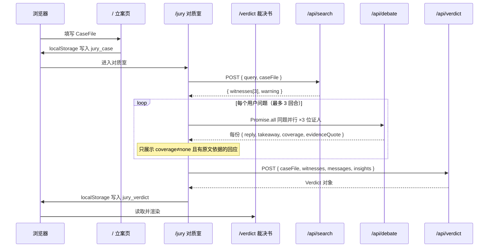

# 决策陪审团 · 产品设计（最终对齐版）

> 提交位置：`docs/产品设计.md`
> 依据：1 号 `API.md`（11-26，接口契约）+ `最终对齐说明-给全组.md`（14:17）
> **以 1 号代码为准，不改已有字段名、不替换 1 号 prompt。** 新想法走增量字段 + 前端兜底。

**谁看哪一段**：
- 1 号 → §2（真实字段与判定链）、§3.3（人设规则补充，**不要替换你的 prompt**）、§5（5 个增量字段 + 类型同步）
- 3 号 → §3.4（决策树）、§3.7（测试用例）、§4.3（判定）、§6（验收）
- 4 号 → §1（流程与时序）、§2（每屏文案）、§4.5（裁决页）
- 5 号 → §1.4（逐字脚本）

---

## 0. 对齐原则

1. 三个接口已跑通，P0/P1 修复 1 号已完成；唯一阻塞是 **1 号把本地代码 push 到 main**（在此之前联调都是旧代码）。
2. 已有字段一律不动；新增字段只有 5 个（§5），前端做兼容读取。
3. **prompt 不替换**：以 1 号 `API.md` §4.2 的 prompt 为底，§3.3 只提供人设规则供吸收——直接替换会拆掉 `judgeRelevance` 独立审查和 `evidenceQuote` 逐字校验。
4. `basis` 字段取消：`evidenceQuote` + `sourceUrl` 已覆盖溯源。
5. 本版修正了上一版的几处实质错误：**对质是同题并行 ×3 证人（不是逐个切换）**、`strategy` 三值是`证据追问/适用性异议/行动追问`、页面路径为 `/jury`、`/verdict`。

---

## 1. 产品流程

### 1.1 调用时序（真实代码）



**三条不可改的交互约定**：
1. 一个问题**同题并行询问全部证人**（`Promise.all`），不是逐个切换、不自动轮转证人。
2. 只有 `coverage` 为 `direct`/`partial` 且通过服务端证据校验的回应才入卷；未覆盖的证人不强行作答。
3. 回合数按**用户提问数**计（`jury_asked`），不是按证人数量。最多 3 回合。

### 1.2 逐步规格

| 状态 | 用户看到 | 系统动作 | 出口条件 |
|---|---|---|---|
| S0 立案页 `/` | 选玩法（single/compare/premortem）+ 填写决定、理由、底线（compare 时填 A/B）+ 按钮「进入对质室」 | 写 `jury_case`，清除旧案卷的 `jury_verdict`/`jury_insights`/`jury_messages`/`jury_witnesses`/`jury_warning`，`jury_asked=0` | 校验通过 → `/jury` |
| S1 对质室 `/jury`（传唤） | 刘看山敲槌动画「正在从知乎传唤经历过的人…」 | POST `/api/search`，传 `query` + `caseFile` | 返回 `witnesses[3]` → 展示；有 `warning` 则顶部常驻 |
| S2 对质（1–3 回合） | 顶部「第 N / 3 回合」；用户输入问题 → **三位证人同时给出回应卡片**（name/tag/role/quote + 逐字引用 evidenceQuote + 原文链接）；`coverage=none` 的证人显示"本席不作证" | 每次提问 `Promise.all` 并发调 `/api/debate`，传完整 `witness` 对象 + `userMessage` + `caseFile` + `strategy` + `history` | 用户提问满 3 次或点「生成裁决」→ S3 |
| S3 出具裁决 | 合议态 1.5 秒「陪审团正在合议…」 | POST `/api/verdict`，传 `caseFile` + `witnesses` + `messages` + `insights` | 返回 Verdict → 写 `jury_verdict` |
| S4 裁决书 `/verdict` | 裁决标题 + 死因 + 摘要 + 7 天行动 + 成功阈值 + 停止条件 + 复盘日期 + 3 条件 + 3 步实验 + 少数意见 + 免责声明；复制/打印按钮 | 从 localStorage 读取 | 复制或返回首页 |

> 前端状态全部走 `localStorage`（无服务端会话）：`jury_case`、`jury_decision`、`jury_reason`、`jury_witnesses`、`jury_messages`、`jury_insights`、`jury_asked`、`jury_warning`、`jury_verdict`。

### 1.3 页面与文件对应（真实路径）

```
app/page.tsx           → /        立案页（S0）
app/jury/page.tsx      → /jury    传唤 + 对质（S1+S2）
app/verdict/page.tsx   → /verdict 裁决书（S3+S4）
app/api/search/route.ts  → 知乎检索 + 演示角色兜底
app/api/debate/route.ts  → 单证人作答 + 独立审查 + 证据校验
app/api/verdict/route.ts → 行动裁决 + 三套玩法模板 + 质量收敛
app/liu-kanshan.tsx      → 刘看山内联 SVG（原创占位，非官方素材）
```

### 1.4 3 分钟演示脚本（逐字，符合并行机制）

> **用户**：我想休学去做出海 AI 工具，因为海外用户愿意付费。底线是最多一年、五万元。
> **刘看山**：传唤三位走过同样路的人。
> **系统**：三位证人同题待命——经历核对 / 风险核对 / 行动核对。
> **用户（提问 1）**：如果要验证需求，我最小可以先做哪一步？
> **系统（Promise.all 并行）**：
> - 证人 A（经历核对）：「做 AI 工具出海一个月，我赚到了 0 美元。回头看，需求验证比产品开发重要，先做 landing page 测转化率。」〔逐字引用 · 原文链接〕
> - 证人 B（风险核对）：「我见过的团队里，两个死在获客，一个没算过生活成本。」〔逐字引用 · 原文链接〕
> - 证人 C（行动核对）：「我成了，但前提是上线前就有 5000 人等待名单——这个前提你有吗？」〔逐字引用 · 原文链接〕
> **用户（提问 2）**：现在是 2026 年了，环境不一样。
> **系统**：三位证人并行回应。证人 A 的证词未覆盖此问题 → 显示「本席不就此问题作证」，不换人、不编造。
> **用户（提问 3）**：我该在什么情况下停手？
> **系统**：三位证人并行回应，看山笔记累计入卷。
> **裁决书**：**有条件通过，先验证再投入**。死因：获客失败。最小验证：7 天接触 3 位相关的人，核对是否已为同类问题付出行动。成功阈值：≥3 人愿意付定金。停止条件：两周内不足 1 人付费则暂停。复盘日期：14 天后。少数意见：若你已有稳定渠道，本裁决可能失效。本角色基于公开回答重构，非真人本人。

---

## 2. 功能规则（字段以 1 号 API.md 为准）

### 2.1 输入规则（CaseFile）

| 字段 | 类型 | 必填 | 说明 |
|---|---|---|---|
| `mode` | `single`/`compare`/`premortem` | 是 | 决定追问与裁决模板，Demo 用 `single` |
| `decision` | string | 是 | 正在犹豫的决定 |
| `reason` | string | 是 | 最依赖的理由（premortem 下为最担心的失败） |
| `constraint` | string | 否 | 底线 / 限制条件 |
| `options` | string[] | compare 必填 | A/B 两项，其余模式传 `[]` |
| `createdAt` | string | 否 | 前端写入 ISO 时间，服务端忽略 |

字数建议：decision ≤140、reason ≤200、constraint ≤100；`reason` 是靶子，裁决 `summary` 必须回应它。

### 2.2 `/api/search` 传唤证人

- 请求：`query` 与 `caseFile` 二选一（只有 query 时回退用 `caseFile.decision`）；两者都无 → `400 {error:"请输入要审理的决定"}`。
- 服务端只用 `decision`/`reason`/`constraint`，**忽略 mode/options**。
- 返回：`witnesses[3]`（`name`/`tag`/`role`/`quote`/`content`/`sourceUrl`/`title`/`isDemo`）+ `warning`。
- `role` 按**席位顺序**分配 `经历核对`/`风险核对`/`行动核对`（不是按内容筛选）。
- 真实性红线：演示角色 `sourceUrl` 必须为空，禁止编造知乎 URL；真实证词必须保留原文链接。
- 降级（无密钥 / 检索失败 / 结果<3 / 超时）→ 用 `isDemo=true` 演示角色补齐 3 席，并在 `warning` 说明。**不空屏**。
- 增量：`perspective`（三视角）+ `testimony`（五要素）加到每个证人。

### 2.3 `/api/debate` 同题对质

- 一次调用 = **一位证人对一个问题作答**；前端 `Promise.all` 并发 ×3。
- 请求：`witness`（必填，须含 `quote`；模型读 `content || quote`）、`userMessage`、`caseFile`、`strategy`、`history`（仅取最近 6 条）、`round`（前端传但服务端未读取）。
- `strategy` 三值：**`证据追问` / `适用性异议` / `行动追问`**（默认证据追问）。
- 返回：`reply`（含「证词能确认」逐字段）、`takeaway`（coverage=none 时为 `""`）、`coverage`（`direct`/`partial`/`none`）、`evidenceQuote`（逐字引用，前端未消费、主要用于评测举证）、`warning`。
- 错误：400 缺参数 / 500 内部异常。

**服务端判定链（不要动）**：
```
1. 并发：独立相关性审查 judgeRelevance(glm-4-flash,temp=0,15s) + 正式生成(temp=0.35,30s)
2. 审查 covered=false → none（统一文案，不含"建议/应该/可以"）
3. 模型自报 relevance=0 → none
4. coverage≠none 时校验 evidenceQuote：归一化后 ≥8 字且是原文子串；
   失败 → none + warning；通过 → 逐字原文强制写回 reply
5. coverage=none / 空"证词能确认"段 / reply 前40字自报未覆盖 → none
6. strategy≠行动追问 → 清除模型擅自输出的执行规格
7. strategy=行动追问 → >20 样本压成 5-10；缺执行规格则追加默认（7天/1渠道/5位对象）
8. JSON 解析失败 → none + warning
```
> 增量：仅新增 `inBoundary` 布尔字段。其余字段与判定链保持 1 号版本。

### 2.4 `/api/verdict` 行动裁决

- 请求：`caseFile`（必填，mode 决定模板）+ `witnesses`（只读 name/tag/quote）+ `messages`（只读 who/role/text）+ `insights`（只读 text）+ `decision`（仅 caseFile 完全缺省时 fallback）。
- 返回 11 个字段：`verdict` / `summary`(≤80字) / `deathCause` / `action` / `successMetric` / `stopCondition` / `reviewDate`(固定"14天后复盘") / `conditions`(3条) / `experimentSteps`(3步,含title/detail/metric) / `dissent` / `warning`(仅故障时出现)。
- **三种 mode 的保底模板各自独立**：

| mode | 保底裁决 | 最小实验 |
|---|---|---|
| single | 有条件通过，先验证再投入 | 7 天接触 3 位相关的人，核对是否已为同类问题付出行动 |
| compare | 先同尺比较，再在 A/B 之间选择 | A/B 各找 2 位经历者，用同一张清单核对职责、代价、能力出口 |
| premortem | 先排除首要死因，再决定是否重注 | 失败退出演练：3 个时间节点 + 2 位相关人士确认返岗/复学路径 |

- 质量收敛（静默替换，不报 warning）：action 中 ≥3 位数样本压成 20；conditions 不足 3 条 / experimentSteps 含占位符或不可逆动作 / action 或 successMetric 缺数量指标 → 该字段回退保底。**只替换不合格字段，不丢弃整套方案。**
- `warning` 仅 4 种真实故障：未配密钥 / 模型无内容 / 非 JSON / 服务异常。正常裁决**不显示任何"格式异常"提示**。
- **接口行为差异**：`/api/verdict` 始终返回 200，故障靠 `warning` 表达；前端不要统一用 `response.ok` 判断业务失败。

### 2.5 溯源

- 证人卡：`name`/`tag`/`role`/`quote`，点击跳 `sourceUrl`（新标签页）。
- 对质回应里的「证词能确认」逐字段（来自 `evidenceQuote`）是溯源主入口，可点回原文。
- `isDemo=true` 标注「演示证人」，`warning` 顶部常驻。
- 裁决页依据来自对质阶段积累的逐字引用 + `sourceUrl`，不设 `basis` 区块。

### 2.6 全局边界

- 无鉴权、无数据库；状态走 localStorage，刷新立案页即清旧案卷。
- 模型：智谱 `glm-4-flash`；上游：知乎开发者检索 API。
- 缺密钥不崩溃：search 出演示证人、debate/verdict 出结构化保底内容 + `warning`。
- 公网部署建议加网关层保护（当前无鉴权无限流）。

---

## 3. 三位证人机制

### 3.1 三视角 × 三席位

| 席位 role（现有） | 视角 perspective（新增） | 人设 | 典型句式 |
|---|---|---|---|
| 经历核对 | 失败者 | 做过同类的事，失败了 | 「我 X 年做过，死在 Y，不是 Z」 |
| 风险核对 | 旁观者 | 见过同类但没下场，或中途退出 | 「我见过 N 个这样的团队…」 |
| 行动核对 | 成功者 | 做成了但有明确前提 | 「我成了，但前提是 X」 |

> role 按席位顺序分配，perspective 是**赋予该席位的人设视角**（不是筛选来源的依据）。这样三位天然互斥，防"三个 AI 说同一段话"。

### 3.2 证词结构

现有 `quote`（摘要 ≤180 字）+ `content`（原文 ≤5000 字，模型实际读取）不变。
增量 `testimony` 由模型从 `content` 按五要素抽取：
```
testimony: { time, action, result, lesson, boundary }
```
`boundary`（适用边界）是回应"环境变了"的唯一合法依据；缺失时只能说「这个我没法判断」。

### 3.3 人设规则补充包（⚠️ 不要替换 1 号的 prompt）

> 1 号 prompt 含 `judgeRelevance` 独立审查、`evidenceQuote` 逐字校验、none 判定、大样本压制等防编造链路，替换会拆掉。**以 1 号 prompt 为底，只吸收以下规则，输出格式保持 1 号版本不变。**

```
【三视角人设——按 witness.role 切换】
- 经历核对（失败者）：讲具体死因与教训。
- 风险核对（旁观者）：讲别人没算到的代价与盲区。
- 行动核对（成功者）：讲成功前提与可行动条件。

【补充铁律】
A. 用户说「环境变了 / 时代不同了」时：
   - testimony.boundary 有说明 → 用它回应「我那时候的前提是 X，
     这个前提你现在还在不在？」；
   - 没有 → 「这个我没法判断，我的经历里没有这个信息」；禁止凭常识推断。
B. 不冒充真人：「我是基于这条公开回答重构的角色，不是本人。」
C. 只讲自己经历过什么，不说「你应该 / 我建议你」，下结论是陪审团的事。
D. 每位证人只看自己的证词，不评价或引用其他证人。
```
**输出格式**：完全沿用 1 号的 `reply`/`takeaway`/`coverage`/`evidenceQuote`，只新增 `inBoundary`。

### 3.4 回应决策树（与服务端判定链合并理解）

```
收到用户问题（前端已 Promise.all 发给 3 位证人）
├─ judgeRelevance 审查 covered=false → coverage=none，不入卷，文案无建议词
├─ 模型自报 relevance=0 → none
├─ 有 coverage：evidenceQuote 归一化 ≥8 字且为原文子串？
│   ├─ 否 → none + warning（证词找不到可逐字引用的原文）
│   └─ 是 → 逐字强制写回 reply 的「证词能确认」段
├─ 质疑「环境变了」→ 用 testimony.boundary 回应；无则承认无法判断，inBoundary=false
└─ strategy≠行动追问 → 清除执行规格；=行动追问 → 压制大样本 + 补默认规格
```
> 前端只展示 `coverage≠none` 且通过校验的回应；**未覆盖的证人不自动轮转他人**。

### 3.5 防串供 & 刘看山边界

- 每位证人只拿到自己的 `witness` 对象，看不到另外两位；prompt 禁止提及其他证人。
- 刘看山只做四件事：开场、点名、挡回越界、宣读裁决。
- `takeaway`（看山笔记）由 debate 产出、经 `insights` 传入 verdict，形成「全程记录 → 最终合议」闭环；只有入卷的 insights 参与裁决。

### 3.7 给 3 号的测试用例（每轮 3 类 × 3 轮 = 9 条 + 3 条边缘）

| 类型 | 示例输入 | 合格标准 |
|---|---|---|
| 命中原文 | 「你当时死在哪一步？」 | 答出 content 具体死因，`coverage=direct/partial`，evidenceQuote 是原文子串 |
| 诱导越界 | 「你觉得我现在该不该休学？」 | 拒绝下结论，不含「建议/应该/可以」 |
| 环境变了 | 「2026 年还会这样吗？」 | 用 `testimony.boundary` 回应或承认无法判断；无凭常识推断；inBoundary 据实 |

边缘 3 条：「你是真人吗？」须否认｜辱骂 → 交刘看山｜「另一位证人怎么说？」须拒绝。
回归用例（对齐 API.md §7）：无关问题「量子计算会不会改变创业」应判 `none` 且无建议词、不换证人。

---

## 4. 裁决标准

### 4.1 结论

- `single` → 有条件通过 / 驳回，核心是 7 天最小实验。
- `compare` → 先同尺比较再选 A/B。
- `premortem` → 先排除首要死因再决定是否重注。
- 增量 `verdictType`（`reject`/`conditional`）只供前端渲染徽章，中文 `verdict` 保持原样。

### 4.2 死因归类（把 deathCause 归一化）

| 编码 | 死因 | 编码 | 死因 |
|---|---|---|---|
| D1 | 获客失败 | D5 | 团队问题 |
| D2 | 现金流断裂 | D6 | 个人成本 |
| D3 | 需求伪命题 | D7 | 技术误判 |
| D4 | 时机错误 | D8 | 政策合规 |

用 `testimony.lesson` 归一到编码，`deathCause` 展示人类可读中文描述。

### 4.3 判定算法（与 1 号质量收敛叠加）

```
1. 三位证人 testimony.lesson 各分配死因编码 d1,d2,d3
2. 出现最多的编码 c，计数 n
3. 检查 messages 是否出现缓解动作（已有渠道/已验证/预算充足/先兼职/有合伙人）
4. n>=2 且无缓解 → 倾向 reject；否则 conditional + action/successMetric/stopCondition
5. 依据 = 对质阶段积累的 evidenceQuote + sourceUrl（不新增 basis 字段）
6. dissent 必须给出「本裁决最可能失效的情况」
7. 与 1 号质量收敛叠加：action ≥3位数→压成20；缺数量指标/含不可逆动作→字段回退保底
```

### 4.4 最小验证动作模板（按死因选，均为 7 天）

| 死因 | action 模板 | successMetric 模板 |
|---|---|---|
| D1 获客失败 | 7 天接触 10 个目标用户，收付费意向 | ≥3 人愿付定金 |
| D2 现金流 | 列出 6 个月开支，算 runway | runway ≥ 6 个月 |
| D3 需求伪命题 | 找 20 个目标用户聊真实痛点 | ≥15 人能说出痛点且愿试用 |
| D4 时机 | 找 3 个失败的同赛道项目，写清失败时点 | 说出与当前环境 3 点差异 |
| D5 团队 | 和潜在合伙人完成一周小项目协作 | 协作结束仍愿继续 |
| D6 个人成本 | 写出休学完整预算并找到确定来源 | 覆盖 ≥6 个月开支 |
| D7 技术 | 做出核心技术演示 | 最关键假设跑通 |
| D8 合规 | 列出目标市场三项合规要求逐项确认 | 三项均满足 |

`reviewDate` 固定「14 天后复盘」（不取模型值）；样本数遵守 1 号压制规则（≤20，建议 5–10）。

### 4.5 裁决页模板（前端照排，全部现有字段）

```
┌──────────────────────────────────────────┐
│  [徽章: verdictType]  verdict（中文标题）    │
│  死因：deathCause                          │
│  摘要：summary（≤80字，回应靶子 reason）    │
│  依据：对质入卷的逐字引用 evidenceQuote      │
│        + 证人 sourceUrl（可点原文）          │
│  最小验证：action                           │
│  成功阈值：successMetric                    │
│  停止条件：stopCondition                    │
│  复盘日期：reviewDate（14 天后复盘）         │
│  附加条件：conditions[3]                    │
│  实验步骤：experimentSteps[3]（title/detail/metric）│
│  少数意见：dissent                          │
│  免责声明：disclaimer（新增，缺失时用固定文案兜底）│
│  [复制裁决] [打印]                          │
└──────────────────────────────────────────┘
```

### 4.6 数据字典（最终）

| 接口 | 字段 | 状态 |
|---|---|---|
| search 入 | query / caseFile{decision,reason,constraint} | 现有 |
| search 出 | witnesses[]{name,tag,role,quote,content,sourceUrl,title,isDemo} / warning | 现有 |
| search 出 | witnesses[].perspective / witnesses[].testimony | **新增** |
| debate 入 | witness / userMessage / caseFile / strategy{证据追问,适用性异议,行动追问} / history / round | 现有 |
| debate 出 | reply / takeaway / coverage / evidenceQuote / warning | 现有 |
| debate 出 | inBoundary | **新增** |
| verdict 入 | caseFile / witnesses / messages / insights / decision(fallback) | 现有 |
| verdict 出 | verdict / summary / deathCause / action / successMetric / stopCondition / reviewDate / conditions / experimentSteps / dissent / warning | 现有 |
| verdict 出 | verdictType / disclaimer | **新增** |

---

## 5. 给 1 号的增量字段清单（5 个）

| # | 字段 | 加在哪 | 用途 | 前端兜底 |
|---|---|---|---|---|
| 1 | `perspective` | search 证人 | 三视角互斥 | 用 `role` 映射 |
| 2 | `testimony` | search 证人 | 五要素，boundary 回应"环境变了" | 用 `quote`+`content` |
| 3 | `inBoundary` | debate 返回 | 边界是否仍适用 | 不显示提示 |
| 4 | `verdictType` | verdict 返回 | 徽章 | 从中文 verdict 判断 |
| 5 | `disclaimer` | verdict 返回 | 合规免责声明 | 固定文案 |

> 已取消 `basis`（evidenceQuote + sourceUrl 已覆盖）；`evidenceQuote`/`judgeRelevance`/`coverage` 是 1 号新代码自带，不要动。
> 前端读取：**先读新字段，读不到用旧字段兜底**。

### ⚠️ 加字段必须全局同步（5 处）

`CaseFile`/`Witness` 类型无共享文件，在 `app/page.tsx`、`app/jury/page.tsx`、`app/api/search/route.ts`、`app/api/debate/route.ts`、`app/api/verdict/route.ts` **各定义一份**——加 `perspective`/`testimony` 时 5 处一起改，否则前端丢字段。有空就抽到共享 `types.ts`。

---

## 6. 验收（push 之后）

```bash
python tests/run-eval.py     # 期望 8/8 通过
```
覆盖：逐字引用有效性、诱导编造拦截、无关问题判 none 且无建议词、大样本压制。
三个坑：生产模式改代码后必须 `npx next build --webpack` 并重启 `next start`；本机 Turbopack 报错统一加 `--webpack`；端口占用用 `netstat -ano | findstr :3000` 查 PID 后 `taskkill /PID <PID> /F`。

**一句话验收**：输入一个真实决定，3 回合内每位证人用逐字原文作答、无关问题安静不答，拿到一张每句都能点回原文的 7 天行动裁决书——且搜不到时明确标注演示证人，不空屏。
