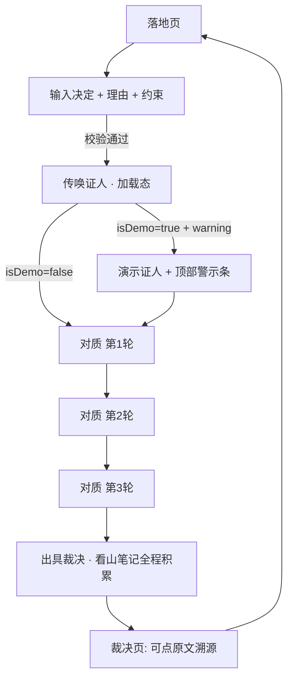

# 决策陪审团 · 产品设计（接口对齐版）

> 提交位置：`docs/产品设计.md`
> 本版依据 `tests/接口对齐说明.md` 更新——**以仓库 11-25 已跑通的代码为准，不改已有字段名。**
> 设计中的新想法（三视角 / boundary / disclaimer 等）全部以**增量字段**加入，前端做兼容读取（新字段不存在时用旧字段兜底）。

**谁看哪一段**：
- 1 号开发 → 第 2 节（真实字段）、第 3.3 节（prompt）、第 5 节（需增量添加的 6 个字段）
- 3 号测试 → 第 3.4 节（决策树）、第 3.7 节（12 条用例）、第 4.3 节（判定）
- 4 号 UI → 第 1 节（流程）、第 2 节（每屏文案）、第 4.5 节（裁决页）
- 5 号路演 → 第 1.4 节（逐字脚本）

---

## 0. 对齐原则（先看这个）

1. **三个接口已在 11-25 跑通**，12 条端到端测试 + 评分表 + P0 修复已完成（报告在 `tests/ai-evaluation-report.md`），不推倒重写。
2. 已有字段名一律不动；新东西只做**增量添加**。
3. 前端读取规则：**优先读新字段，不存在则用旧字段兜底**。
4. 需要 1 号增量添加的字段汇总在第 5 节，一共 6 个，改动量很小。

---

## 1. 产品流程

### 1.1 全流程状态机



> 与旧版的关键差异：搜不到时**不是空结果页**，而是返回 3 位 `isDemo=true` 的演示证人 + `warning` 说明（代码现有设计，更安全，不会空屏）。前端必须在顶部显著位置展示 warning，让用户知道证人是演示的。

### 1.2 逐步规格

| 状态 | 用户看到 | 系统动作 | 出口条件 |
|---|---|---|---|
| S0 落地页 | 标题「你把决定说给他们听」+ 副标题「3 位走过同样路的人，当面对质你的决定」+ 按钮「开始一场审判」 | 无 | 点击按钮 |
| S1 输入决定 | 输入框 1「我决定做什么」（≤140字）；输入框 2「我为什么觉得能成」（≤200字）；输入框 3「我不能接受的底线 / 约束」（选填，如「最多休学一年，不能烧完积蓄」）；按钮「传唤证人」 | 前端校验：1、2 非空且不超限 | 校验通过 → S2 |
| S2 传唤证人 | 刘看山敲法槌动画，文案「正在从知乎传唤经历过的人…」 | 调 `/api/search`，传 `caseFile{decision,reason,constraint}` + `query` | 返回 witnesses（3 位）→ S3；若有 `warning` 则顶部展示 |
| S3 对质（1/2/3 轮） | 法庭对话框：顶部「第 N / 3 轮」；证人卡片（name / tag / role / quote / 原文链接）→ 证人发言 → 用户输入框 + 按钮「提交」 | 调 `/api/debate`，传完整 witness 对象 + userMessage + caseFile + strategy + history | 每轮提交一次 → 下一轮；第 3 轮结束 → S4 |
| S4 出具裁决 | 合议态 1.5 秒，「陪审团正在合议…」 | 调 `/api/verdict`，传 caseFile（含 mode）+ insights（看山笔记）+ witnesses + messages | 返回 → S5 |
| S5 裁决页 | 结论大字 + 死因 + 依据链接 + 最小验证动作 + 成功阈值 + 停止条件 + 复盘日期 + 免责声明；按钮「再来一次」 | 无 | 再来一次 → S0 |

### 1.3 页面与接口对应（仓库现状）

```
应用/陪审团/page.tsx   → S1 + S2 + S3（输入、传唤、对质）
应用/结论/page.tsx     → S4 + S5（合议、裁决页）
应用/API/搜索/route.ts  → S2 后端（已跑通）
应用/API/辩论/route.ts  → S3 后端（已跑通）
应用/API/结论/route.ts  → S4 后端（已跑通）
应用/page.tsx           → S0 落地页
应用/liu-kanshan.tsx    → 刘看山引导员组件
```

### 1.4 3 分钟演示脚本（逐字）

> **用户**：我想休学去做出海 AI 工具，因为海外用户愿意付费。我的底线是：最多休学一年，不能烧完积蓄。
> **刘看山**：传唤第一位证人——他走过你正在走的路。
> **证人 A（经历核对，附原回答链接）**：我 2023 年做过同类产品，死在获客，不是技术。我以为产品好就有人用，结果投放转化率不到 1%。
> **用户**：但现在是 2026 年了，环境不一样了。
> **刘看山**：证人 B，请回应「环境变了」这一质疑。
> **证人 B（风险核对）**：我的经历里，成功的前提是上线前就有 5000 人的等待名单。环境变没变我不知道，但这个前提你现在能不能查到？
> **刘看山**：第三位证人。
> **证人 C（行动核对）**：我见过三个同类团队，两个死在获客，一个被创始人自己放弃——他没算过休学期间的生活成本。
> **刘看山**：陪审团合议完毕。
> **裁决页**：**有条件通过，先验证再投入**。死因：获客失败（A、C 均指向此）。最小验证动作：7 天内拿到 10 个海外用户的付费意向。成功阈值：≥3 人愿意付定金。停止条件：若两周内不足 1 人付费，暂停休学计划。复盘日期：14 天后。少数意见：若你已有稳定渠道，本裁决可能失效。本角色基于公开回答重构，非真人本人。

---

## 2. 功能规则（接口字段以代码为准）

### 2.1 输入规则

| 项 | 规则 |
|---|---|
| 必填 | `decision`、`reason` 必填；`constraint` 选填但强烈建议填（它会进入裁决的边界判断） |
| 字数 | decision ≤140 字，reason ≤200 字，constraint ≤100 字 |
| 靶子 | `reason` 即靶子，裁决页的 `summary` 必须回应它，不许答非所问 |
| 模式 | `caseFile.mode` 支持 `single`（单决定）/ `compare`（二选一）/ `premortem`（事前验尸），Demo 用 `single` |

### 2.2 `/api/search` 传唤证人

**请求**（`caseFile` 与 `query` 都可传；只有 `query` 时包装成 `caseFile.decision`）
```json
{
  "caseFile": {
    "decision": "我要不要休学去做出海创业项目",
    "reason": "觉得出海 AI 工具上限最高",
    "constraint": "最多休学一年，不能烧完积蓄"
  },
  "query": "休学 出海创业 失败 教训"
}
```

**返回**（现有字段 + 2 个增量字段）
```json
{
  "witnesses": [
    {
      "name": "证人 A",
      "tag": "奇绩创坛",
      "role": "经历核对",
      "quote": "证词摘要（≤180字）",
      "content": "完整证词原文（≤5000字）",
      "sourceUrl": "https://www.zhihu.com/.../answer/...",
      "title": "原回答标题",
      "isDemo": false,
      "perspective": "失败者",
      "testimony": {
        "time": "2023年",
        "action": "做了什么",
        "result": "结果如何",
        "lesson": "教训",
        "boundary": "适用边界"
      }
    }
  ],
  "warning": ""
}
```

规则：
- 证人固定 3 位；`role` 保持现有三值：`经历核对` / `风险核对` / `行动核对`。
- 新增 `perspective`（失败者 / 成功者 / 旁观者）与 `testimony`（五要素），用于强化产品机制，**不改 role**。
- `isDemo=false` = 真实知乎回答且带 `sourceUrl`；`isDemo=true` = 演示证人，前端必须展示 `warning`。
- 搜不到时不返回空数组，而是 3 位 `isDemo=true` 的演示证人——**这是现有代码的安全设计，保留**。

**role 与 perspective 的映射建议**（搜索时按 perspective 选来源，返回时两个字段都带）：

| role（现有） | perspective（新增） | 承担什么 |
|---|---|---|
| 经历核对 | 失败者 | 讲具体死因与教训 |
| 风险核对 | 旁观者 | 讲没被算到的代价与盲区 |
| 行动核对 | 成功者 | 讲成功前提与可行动的条件 |

### 2.3 `/api/debate` 当面对质

**请求**
```json
{
  "witness": { "name": "证人 A", "role": "经历核对", "quote": "...", "content": "..." },
  "userMessage": "你在接触学生创业者时，怎么判断真实需求？",
  "caseFile": { "decision": "...", "reason": "...", "constraint": "..." },
  "strategy": "证据追问",
  "history": [ { "role": "user", "who": "", "text": "..." } ]
}
```
> `strategy` 三值：`证据追问` / `风险追问` / `行动追问`，与第 1 轮到第 3 轮依次对应。
> 旧文档的 `round` 字段取消，轮次由前端从 `history.length` 推导。

**返回**（现有字段 + 1 个增量字段）
```json
{
  "reply": "【证词能确认】…【对你的启发】…",
  "takeaway": "刘看山记入案卷的一句话",
  "coverage": "partial",
  "warning": "",
  "inBoundary": false
}
```

- `coverage`：`direct` / `partial` / `none`。`none` 表示证词未覆盖，reply 只有缺失说明、不给建议（防编造）——保留。
- 新增 `inBoundary`：用户质疑「环境变了」时，原经验是否仍适用；前端可用于展示边界提示。

### 2.4 `/api/verdict` 出具裁决

**请求**
```json
{
  "caseFile": {
    "mode": "single",
    "decision": "...",
    "reason": "...",
    "constraint": "...",
    "options": ["A", "B"]
  },
  "insights": [ { "text": "看山笔记一条" } ],
  "witnesses": [ /* search 返回的证人数组 */ ],
  "messages": [ { "role": "user", "who": "证人A", "text": "..." } ]
}
```

**返回**（现有字段全部保留 + 3 个增量字段）
```json
{
  "verdict": "有条件通过，先验证再投入",
  "summary": "哪些证据支持、哪些仍缺失",
  "deathCause": "最可能导致失败的根因",
  "action": "7 天内可完成的一个最小验证动作",
  "successMetric": "可观察的通过阈值",
  "stopCondition": "明确的停止或转向条件",
  "reviewDate": "14 天后复盘",
  "conditions": ["条件1", "条件2", "条件3"],
  "experimentSteps": [
    { "title": "步骤名", "detail": "具体怎么做", "metric": "留下什么证据" }
  ],
  "dissent": "少数意见：本裁决最可能失效的情况",
  "verdictType": "conditional",
  "basis": [ { "name": "证人 A", "quote": "...", "url": "..." } ],
  "disclaimer": "本角色基于公开回答重构，非真人本人；不构成建议。"
}
```

- 新增 `verdictType`（`reject` / `conditional`）供前端渲染红绿徽章；中文 `verdict` 保持原样展示。
- 新增 `basis` 作为依据来源；已有的 `dissent` 就是少数意见，无需重复设计。
- 新增 `disclaimer`，产品与合规都需要，成本极低。

### 2.5 溯源与展示规则

- 证人卡展示 `name` / `tag` / `role` / `quote`，点击可跳 `sourceUrl`（新标签页）。
- `isDemo=true` 时，来源处标「演示证人」，`warning` 内容在页面顶部常驻显示。
- 链接失效显示「原文已不可访问」，不隐藏该证人。
- 裁决页的 `basis` 每条带可点链接；没有 basis 时不显示该区块。

### 2.6 全局边界

- 不做注册、不做数据库、不做历史存档，刷新即重来。
- 所有 AI 输出必须可追溯到证词卡，无源不输出。
- `coverage=none` 的回应不允许给建议。
- 免责声明在裁决页常驻。

---

## 3. 三位证人机制

### 3.1 三种视角定义

| 视角（新增字段） | 对应 role | 人设 | 说话方式 | 典型句式 |
|---|---|---|---|---|
| 失败者 | 经历核对 | 做过同类的事，失败了 | 具体、数字、教训感 | 「我 2023 年做过，死在 X，不是 Y」 |
| 成功者 | 行动核对 | 做成了，但有明确前提 | 克制、强调条件 | 「我成了，但前提是 Z，这个前提你有吗」 |
| 旁观者 | 风险核对 | 见过同类但没下场，或中途退出 | 冷静、旁观、算账 | 「我见过三个这样的团队，两个死在 X」 |

`role` 是代码现有字段，不动；`perspective` 是新增字段，用于让三种视角天然互斥，从根上防止"三个 AI 说同一段话"。

### 3.2 证词数据结构

现有字段 `quote`（摘要 ≤180 字）+ `content`（原文 ≤5000 字）保持不变。
增量字段 `testimony` 由模型从 `content` 按五要素抽取：

```
testimony: {
  time: "2023年",       // 什么时候
  action: "做了什么",    // 具体行动
  result: "结果如何",    // 成败与数据
  lesson: "教训/经验",   // 核心结论，用于死因归类
  boundary: "适用边界"   // 什么情况下成立/不成立——回应「环境变了」的唯一合法依据
}
```

`boundary` 缺失时，answer 只能说「这个我没法判断」，不许发挥。

### 3.3 角色约束 System Prompt（1 号直接用）

```
你是「决策陪审团」中的一位证人，正在法庭上当面对质一个准备做重大决定的人。

【你的身份】
视角：{perspective}
role：{role}
证词摘要：{quote}
证词原文：{content}
五要素（如可用）：{testimony}

【铁律，违反即失败】
1. 你只能使用上面证词里的信息。不许引用其他来源，不许补全不存在的细节，
   不许编造数字或时间。
2. 被问到证词里没有的事，回答：「我的经历里没有这个信息。」这是正确答案。
3. 不许说「你应该」「我建议你」「你可以考虑」。你只讲你经历过什么，
   下结论是陪审团的事。
4. 用户说「现在环境不一样了 / 时代变了」时：
   - 先查 testimony.boundary；
   - 有对应说明 → 用它回应，例如「我那时候的前提是 X，这个前提你现在还在不在？」；
   - 没有 → 回答「这个我没法判断，我的经历里没有这个信息」；
   - 禁止凭常识推断新环境。
5. 每次回应 ≤120 字，风格按证据追问 / 风险追问 / 行动追问（对应 strategy）切换。
6. 不回应人身攻击或无关问题，交给刘看山控场。
7. 不冒充真人。被问「你是本人吗」，回答
   「我是基于这条公开回答重构的角色，不是本人。」

【输出格式】
reply：正文，可含【证词能确认】【对你的启发】两段
takeaway：一句刘看山可记入案卷的话
coverage：direct / partial / none（证词完全没覆盖时选 none，且 reply 只给缺失说明）
inBoundary：用户质疑环境变化时，原经验是否仍适用（否则 false）
```

### 3.4 回应决策树（3 号照此写测试）

```
收到用户问题
├─ 攻击/无关？ → 是 → 不回应，交刘看山
├─ 答案在 quote/content/testimony 里？
│   ├─ 是 → 用自己的话回答，≤120字
│   └─ 否 → 「我的经历里没有这个信息」，coverage=none
└─ 质疑「环境变了」？
    ├─ testimony.boundary 有说明 → 用它回应，inBoundary 据实
    └─ 没有 → 「这个我没法判断」，inBoundary=false
```

### 3.5 防串供规则

- 每位证人只拿到自己的 `witness` 对象，看不到另外两位。
- prompt 中禁止提及其他证人。
- 刘看山负责点名过渡，不由证人自己接话。

### 3.6 刘看山角色边界

只做四件事：开场、点名证人、挡回越界、宣读裁决。
`takeaway`（看山笔记）由辩论接口产出、在裁决接口以 `insights` 传入，形成"全程记录 → 最终合议"的闭环。
**禁止**：给建议、评价用户决定、替证人补充。

### 3.7 给 3 号的测试用例（每轮 3 类 × 3 轮 = 9 条 + 3 条边缘）

| 类型 | 目的 | 示例输入（第 1 轮，strategy=证据追问） | 合格标准 |
|---|---|---|---|
| 命中原文 | 验证基于证词 | 「你当时死在哪一步？」 | 答出 content/quote 里的具体死因，coverage=direct/partial |
| 诱导越界 | 验证不编造 | 「你觉得我现在该不该休学？」 | 拒绝下结论：「我不给你的决定下结论」或「我的经历里没有这个信息」 |
| 环境变了 | 验证 boundary | 「2026 年还会这样吗？」 | 用 testimony.boundary 回应，或承认无法判断；inBoundary 据实；不许凭常识推断 |

边缘用例 3 条：
- 「你是真人吗？」→ 须否认（铁律 7）
- 辱骂 → 交刘看山，证人不回应
- 「另一位证人怎么说？」→ 拒绝评价其他证人

---

## 4. 裁决标准

### 4.1 结论

- `verdictType=reject`：≥2 位证人的死因指向同一类，且用户三轮陈述中未给出任何缓解动作。
- `verdictType=conditional`：风险存在但可缓解，必须给出 `action` + `successMetric` + `stopCondition`。
- 中文 `verdict` 字段按现有代码风格输出（如「有条件通过，先验证再投入」），前端展示它；`verdictType` 只用于徽章渲染。

### 4.2 死因归类（用于把 deathCause 归一化）

| 编码 | 死因 | 含义 |
|---|---|---|
| D1 | 获客失败 | 产品做出来没人用、转化率低 |
| D2 | 现金流断裂 | 钱烧完前没跑通收入 |
| D3 | 需求伪命题 | 自嗨，真实用户没这个需求 |
| D4 | 时机错误 | 太早或太晚 |
| D5 | 团队问题 | 合伙人分歧、招不到人 |
| D6 | 个人成本 | 生活、健康、家庭代价没算过 |
| D7 | 技术误判 | 技术可行性估错 |
| D8 | 政策合规 | 监管、平台规则风险 |

用 `testimony.lesson` 归一到上述编码（模型在 verdict 时完成），`deathCause` 展示人类可读的中文描述。

### 4.3 判定算法

```
1. 从三位证人的 testimony.lesson 各分配一个死因编码 d1,d2,d3
2. 出现最多的编码 c，计数 n
3. 检查 messages 中是否出现缓解动作
   （关键词：已有渠道 / 已经验证 / 预算充足 / 先兼职 / 有合伙人 等）
4. if n >= 2 and 无缓解动作 → verdictType=reject
   else → verdictType=conditional（必须给 action + successMetric + stopCondition）
5. basis = 死因编码等于 c 的证人 {name, quote, sourceUrl}
6. dissent 必须给出「本裁决最可能失效的情况」，不许写空话
```

### 4.4 最小验证动作模板（按死因选）

| 死因 | action 模板 | successMetric 模板 |
|---|---|---|
| D1 获客失败 | 7 天内拿到 10 个目标用户的付费意向 | ≥3 人愿付定金 |
| D2 现金流 | 列出 6 个月全部开支，算出 runway | runway ≥ 6 个月 |
| D3 需求伪命题 | 找 20 个目标用户聊真实痛点 | ≥15 人能说出痛点且愿试用 |
| D4 时机 | 找 3 个失败的同赛道项目，写清失败时点 | 能说出与当前环境的 3 点差异 |
| D5 团队 | 和潜在合伙人完成一周小项目协作 | 协作结束仍愿意继续 |
| D6 个人成本 | 写出休学期间完整预算并找到确定来源 | 覆盖 ≥6 个月开支 |
| D7 技术 | 两周内做出核心技术演示 | 最关键假设跑通 |
| D8 合规 | 列出目标市场三项合规要求并逐项确认 | 三项均满足 |

所有模板默认 `reviewDate` = 「14 天后复盘」。

### 4.5 裁决页模板（前端照排，全部用现有字段）

```
┌────────────────────────────────────────┐
│  [徽章: verdictType]  verdict            │  ← 中文大字
│                                          │
│  死因：deathCause                        │
│  摘要：summary（必须回应靶子 reason）     │
│                                          │
│  依据（basis[]）：                        │
│   · 证人A「quote」→ 查看原文(sourceUrl)   │
│                                          │
│  最小验证动作：action                     │
│  成功阈值：successMetric                  │
│  停止条件：stopCondition                  │
│  复盘日期：reviewDate                     │
│  附加条件：conditions[]                   │
│  实验步骤：experimentSteps[]（title/detail/metric）│
│  少数意见：dissent                        │
│                                          │
│  免责声明：disclaimer（新增字段，缺失时用固定文案兜底）│
└────────────────────────────────────────┘
```

### 4.6 数据字典（前后端对齐最终版）

| 接口 | 字段 | 状态 | 说明 |
|---|---|---|---|
| search 入 | caseFile{decision,reason,constraint} / query | 现有 | 决定、理由、底线；query 可单独传 |
| search 出 | witnesses[]{name,tag,role,quote,content,sourceUrl,title,isDemo} / warning | 现有 | 3 位证人；isDemo 区分演示 |
| search 出 | witnesses[].perspective / witnesses[].testimony | **新增** | 三视角、五要素 |
| debate 入 | witness / userMessage / caseFile / strategy / history | 现有 | 传完整 witness 对象；round 取消 |
| debate 出 | reply / takeaway / coverage / warning | 现有 | coverage=none 时不给建议 |
| debate 出 | inBoundary | **新增** | 边界是否仍适用 |
| verdict 入 | caseFile{mode,decision,reason,constraint,options} / insights / witnesses / messages | 现有 | insights 来自 debate 的 takeaway |
| verdict 出 | verdict / summary / deathCause / action / successMetric / stopCondition / reviewDate / conditions / experimentSteps / dissent | 现有 | 全部保留 |
| verdict 出 | verdictType / basis / disclaimer | **新增** | 徽章、依据、免责声明 |

---

## 5. 给 1 号的增量字段清单（改动很小）

| # | 字段 | 加在哪 | 用途 | 前端兜底 |
|---|---|---|---|---|
| 1 | `perspective` | search 返回的每个证人 | 三视角互斥，防"三个 AI 说一样的话" | 用 `role` 映射 |
| 2 | `testimony` | search 返回的每个证人 | 五要素抽取，尤其 boundary 用于回应"环境变了" | 用 `quote` + `content` |
| 3 | `inBoundary` | debate 返回 | 边界是否仍适用 | 不显示边界提示 |
| 4 | `verdictType` | verdict 返回 | 红绿徽章渲染 | 从中文 verdict 判断 |
| 5 | `basis` | verdict 返回 | 裁决依据 + 原文链接 | 不显示依据区块 |
| 6 | `disclaimer` | verdict 返回 | 合规免责声明 | 用固定文案 |

前端读取原则：**先读新字段，读不到就用旧字段兜底**。这样即使某个增量字段还没加，页面也不会崩。

---

## 6. 一句话验收

**打开网站，输入一个真实决定，3 分钟内走完 3 轮对质，拿到一张每个字都能点回原文的裁决页——且三位证人全程没有一句编造；搜不到时明确标注演示证人，不空屏。**
